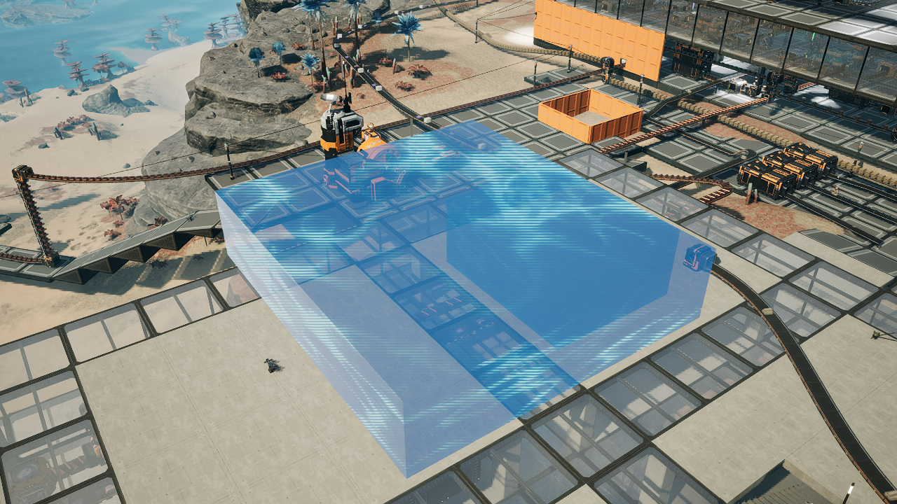

# V01. Рассчитать и показать общий габарит плана

**Зависимости** — можно начинать с 0.1.1.

**Статус** — выполнена, оба пункта приёмки пройдены.

## Цель

Получить Footprint из сохранённых габаритов деталей в локальных осях плана.

## С чего начать

У каждой детали есть `BoundsCenter`, `BoundsSize` и `InPlan`. Размеры записаны в сантиметрах как полная длина по осям. Отдельное размещение задаёт `Plan.Transform`. [Данные снимка](../../src/ShadowArchitect/Source/ShadowArchitect/Private/ShadowPlan.h) · [Рендер проекции](../../src/ShadowArchitect/Source/ShadowArchitect/Private/ShadowProjection.cpp) · [Захват геометрии](../../src/ShadowArchitect/Source/ShadowArchitect/Private/ShadowCapture.cpp)

## Работа

1. Для каждой детали получите восемь углов из центра и полуразмеров. Преобразуйте их через `InPlan` и объедините в один бокс в осях плана.
2. Постройте один параллелепипед относительно корня визуального актора. Отдельный переключатель режимов появится в V03.

## Независимая проверка

- [x] Числовой пример без масштаба: кубы стороной 100 см с центрами (0,0,0) и (200,0,100) дают центр (100,0,50) и размеры (300,100,200).
- [x] Добавьте вытянутую деталь, повёрнутую на 90° внутри плана. Проверьте включение всех углов. Поверните сам план на 90° — размеры в его осях прежние. Повторите показ после загрузки без файла Blueprint.

## Результаты приёмки

23 ноября 2026 года. Код из `d14da71`. Игровая сборка — Satisfactory Steam Shipping CL `520140`, SML `3.12.1`, Shadow Architect `0.1.1`. Входной слот `SAQ_BASE_01`, сеанс `SAQ01`. Прогон выполнен в режиме чтения, выходной слот не создавался. SHA-256 входного слота совпал до и после прогона.

- **Два куба.** Ожидали центр `(100, 0, 50)` и размеры `(300, 100, 200)` см. Фактический расчёт дал те же значения.
- **Вытянутая деталь.** Добавили деталь `400 × 60 × 40` см с локальным центром `(40, −10, 15)`, переносом `(280, 50, 140)` и поворотом на 90° внутри плана. Ожидали центр `(135, 90, 62.5)` и размеры `(370, 400, 225)` см. Фактический расчёт дал те же значения. Дополнительный случай с поворотом на 45° и масштабом проверил учёт всех углов. Оба теста `ShadowArchitect.Footprint` прошли.
- **Загрузка и поворот в Steam Shipping.** При пустой библиотеке Blueprint ожидали две видимые проекции по одному боксу на план. Игра восстановила обе. Ожидаемые по сохранённым деталям и измеренные размеры совпали у обоих планов — `4202.685 × 3803.818 × 905.083` и `2013.452 × 1688.751 × 914.822` см. SaveCheck повернул оба плана на 90° и повторно измерил те же размеры в локальных осях.

```text
version=0.1.1 enabled=1
blueprints=0
plan=0 turned_90=1 local_size_cm=(X=4202.685 Y=3803.818 Z=905.083) unchanged=1
plan=1 turned_90=1 local_size_cm=(X=2013.452 Y=1688.751 Z=914.822) unchanged=1
subsystems=1 restored=2 views=2 visible=2 geometry_pass=1
```



## Что передать проверяющему

Приложите ожидаемые и полученные размеры в см и один игровой кадр. Сохраняемые положения деталей остаются источником геометрии.

[Индекс задач и условия игрового прогона](../work-plan.md)
