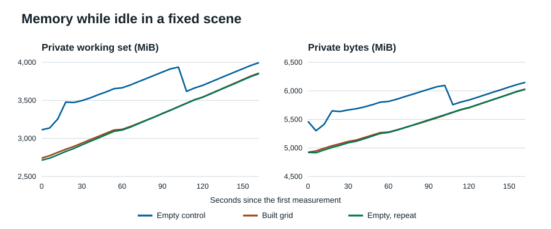

# Satisfactory process memory grows while idle on an unchanged save

Draft for Coffee Stain QA. The issue was measured in Steam Shipping **1.2.5.1 CL 520140** (`++FactoryGame+rel-main-1.2.6-CL-520140`) on Windows using D3D12 and a GeForce RTX 5080 with driver 621.01. The tested process used the system `dxgi.dll`. SML, Shadow Architect, SaveCheck, and OptiScaler were absent during measurement.

## Steps to reproduce

1. Start a fresh process in the Steam client with `-dx12 -RenderOffscreen -windowed -ResX=1280 -ResY=720`. The recorded runs used `-ExecCmds="t.MaxFPS 0,r.VSync 0,t.IdleWhenNotForeground 0"`.
2. Load a vanilla save. The reference run used `SAQ_F11_VANILLA_EMPTY`, a save without the test grid, loaded at startup using `GameMapsSettings.GameDefaultMap=/Game/FactoryGame/Map/GameLevel01/Persistent_Level` and `LocalMapOptions=?loadgame=SAQ_F11_VANILLA_EMPTY?sessionName=SAQF11Vanilla`.
3. Leave the player and camera still for 162 seconds. Record both counters for the same PID throughout this interval. Measure the starting value at least 3 seconds after the engine reports that the map finished loading.
4. For a geometry comparison, restart the game and load a copy with a 10×10 grid of one Blueprint in the same location. The reference grid included ceiling lights, wall power poles, and power lines. Repeat the same idle interval.

Use an external process sampler. The reference measurements sample Windows private working set and private bytes at 5 Hz and compare medians over 0.9-second windows. Ordinary game garbage collection was left active. Keep other programs and graphics settings comparable between runs.

## Expected behavior

An unchanged scene should eventually reach a stable memory range after assets and other resources warm up. The measurements cover the first 162 seconds after load.

## Observed behavior

Leaving the empty save idle for 162.1 seconds raised the private working set by **922 and 1,158 MiB** in two fresh processes. Private bytes rose by **804 and 1,037 MiB**, respectively. The built save grew by **1,143 and 1,014 MiB**, within the range seen with the empty save for both counters. These observations cover offscreen rendering and can be repeated without travelling between maps. [Static probe measurements](../../evidence/F11-renderer-probes.csv)

## Player impact

The game process uses more RAM and commits more private memory during the measured idle interval, leaving less memory headroom for other applications. The tests did not observe a crash or measure the effect on frame time. The counters cannot identify the owner of individual allocations or show whether memory levels off after the measured interval.
