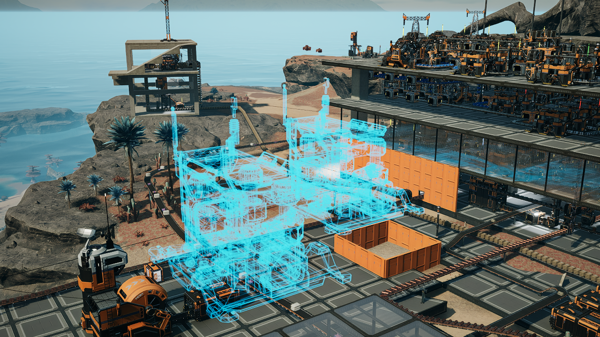
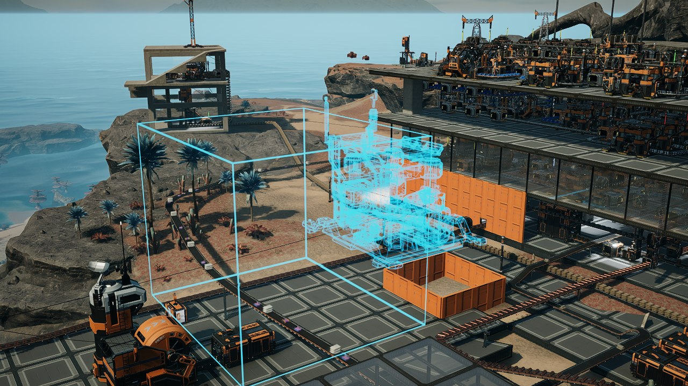

# V02. Реализовать контуры отдельных зданий

**Зависимости** — можно начинать с 0.1.1.

**Статус** — выполнена, оба пункта приёмки пройдены.

## Цель

Реализовать контурное представление Wireframe.

## С чего начать

`AShadowProjection::Build` сегодня применяет один материал ко всем слотам меша. Для утраченного меша уже предусмотрен габаритный proxy. Wireframe должен читаться на сложном станке в упакованном клиенте. [Рендер проекции](../../../src/ShadowArchitect/Source/ShadowArchitect/Private/ShadowProjection.cpp) · [Захват геометрии](../../../src/ShadowArchitect/Source/ShadowArchitect/Private/ShadowCapture.cpp) · [Данные снимка](../../../src/ShadowArchitect/Source/ShadowArchitect/Private/ShadowPlan.h)

## Работа

1. Выберите воспроизводимый в Shipping способ рисования контуров. Проверьте его на видимом меше со множеством внутренних рёбер.
2. Сохраните относительные позы всех деталей и экземпляров. Для детали без доступного меша рисуйте габаритный контур в её локальных осях. Подключение клавиши оставьте V03.

## Независимая проверка

- [x] Поставьте два станка один за другим с частичным перекрытием. На кадре видны формы обоих, через передний виден задний и фон.
- [x] В тестовой копии воспроизведите ветку недоступного меша для одной детали. Видны рёбра её габарита, остальные детали сохраняют свои контуры. Проверьте в Steam Shipping с приготовленными материалами.

## Результаты приёмки

23 ноября 2026 года. Рабочие изменения поверх `60df5d6`, Satisfactory Steam Shipping CL `520140`, SML `3.12.1`, Shadow Architect `0.1.1`. Входной слот `SAQ_BASE_01`, сеанс `SAQ01`. Прогон выполнен в режиме чтения, выходной слот не создавался.

- **Обычные меши.** Тестовая сцена вызвала `BuildWireframe` для двух частично перекрывающихся `ConstructorMk1`. У каждого было шесть компонентов меша и 38 241 треугольник в LOD0. На кадре различимы оба станка и фон в области перекрытия.
- **Недоступный меш.** Для одного меша переднего станка тестовая сцена подставила отсутствующий путь. Игра показала только рёбра габарита этой детали. Задний станок сохранил контуры. Тест `ShadowArchitect.Wireframe.Parts` также подтвердил позу обычного меша и размеры proxy в локальных осях детали.

Оба кадра сняты в Steam Shipping с приготовленными материалами. Игрок сможет выбирать представление после V03.

```text
expected_material=M_ShadowWireframe match=1 components=6 lod0_triangles=38241
expected_material=M_ShadowWireframe match=1 components=6 lod0_triangles=38241
forced_missing=/ShadowArchitect/QA/DeliberatelyMissing.DeliberatelyMissing
expected_material=M_ShadowBoxEdges match=1 components=1 lod0_triangles=48
pass=1
```





## Что передать проверяющему

Приложите кадры обычного меша и proxy, укажите сборку. Только редакторный вид Wireframe не подтверждает результат в игре.

[Индекс задач и условия игрового прогона](../../work-plan.md)
