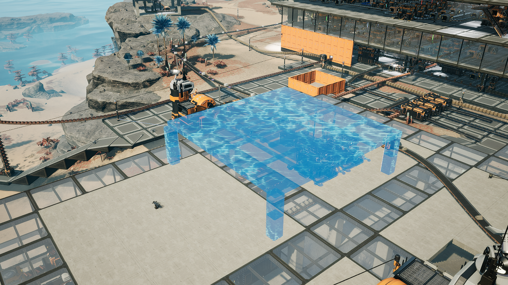
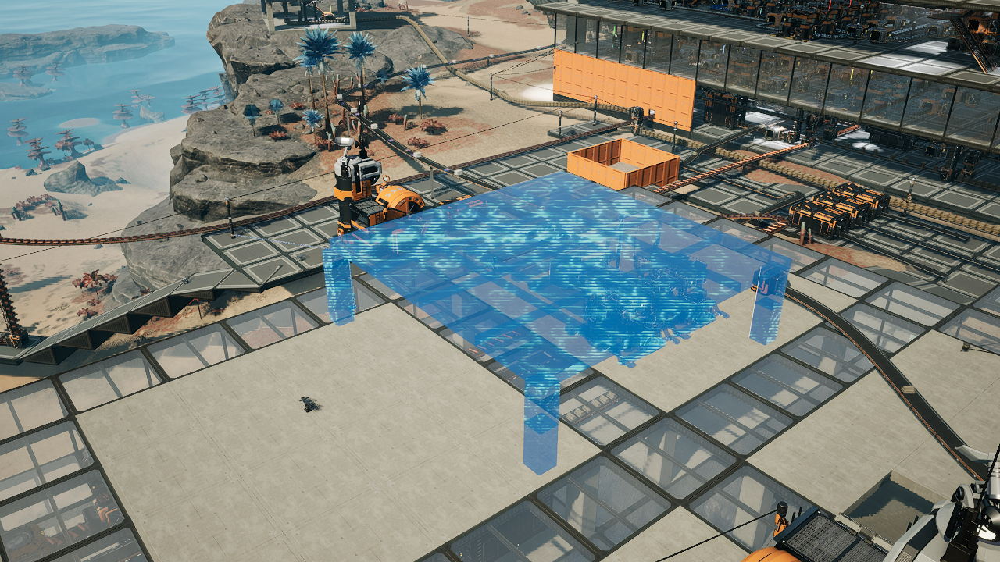

# V03. Переключать три способа отображения

**Зависимости** — [V01](01-plan-footprint.md), [V02](02-building-wireframes.md).

**Статус** — оба игровых сценария и проверка установочного архива 0.1.2 пройдены.

## Цель

Дать игроку переключатель Ghost → Wireframe → Footprint → Ghost.

## С чего начать

`ShowPlan` создаёт актор и применяет `bVisible`, `Restore` пересоздаёт представления. Используйте результаты V01 и V02 также при создании нового плана в уже выбранном режиме. [Управление планами](../../../src/ShadowArchitect/Source/ShadowArchitect/Private/ShadowPlan.cpp) · [Рендер проекции](../../../src/ShadowArchitect/Source/ShadowArchitect/Private/ShadowProjection.cpp) · [Данные снимка](../../../src/ShadowArchitect/Source/ShadowArchitect/Private/ShadowPlan.h)

## Работа

1. Введите общее состояние вида и одно действие переключения. Укажите привязку в управлении. Порядок — Ghost, Wireframe, Footprint, Ghost.
2. Применяйте выбранный вид к существующим и новым акторам. Старые компоненты представления освобождайте при замене. Общее скрытие имеет силу во всех трёх видах.

## Независимая проверка

- [x] При двух планах пройдите полный цикл трижды. Сравните исходный и конечный кадры, GUID, позы и число акторов. Каждый Footprint содержит один бокс на размещение.
- [x] Перейдите в Wireframe и добавьте третий план. Он сразу контурный. Скройте планы, переключите вид на Footprint, затем верните видимость — появятся три габарита.
- [x] Повторите оба сценария на DLL из установочного архива и сверьте SHA-256 установленной DLL с DLL из ZIP.

## Результаты приёмки

23 ноября 2026 года. Ревизия мода `448e9d6`, Satisfactory Steam Shipping CL `520140`, SML `3.12.1`, Shadow Architect `0.1.2`. Входной слот `SAQ_BASE_01`, сеанс `SAQ01`. Выходной слот не создавался. SHA-256 входного слота совпал до и после двух прогонов.

Установили `dist/ShadowArchitect-0.1.2-Steam-Windows.zip` в отдельную копию Steam-клиента. SaveCheck подключили отдельным плагином. Оба прогона зафиксировали `version=0.1.2`, `installed_module=1` и `pass=1 completed`. Путь загруженного модуля указывал на `FactoryGame/Mods/ShadowArchitect/Binaries/Win64/FactoryGameSteam-ShadowArchitect-Win64-Shipping.dll`. SHA-256 этой DLL совпал с DLL из архива перед каждым запуском и после обоих прогонов. [Как повторить проверку](../../background-testing.md#v03-проверка-dll-из-установочного-архива)

```text
ZIP SHA-256  0154C407A179B8F654DA164EF26B7EC6790411FC62AD995CADA306CC9168C013
DLL SHA-256  4E7AEADFB6CA3F95DB571F6B993680DA4DF38355106E7F54BB0A0C8EBD7BA088
```

1. Загрузили два плана в Ghost. Девять нажатий `Ctrl+Shift+G` трижды дали Wireframe → Footprint → Ghost. В Ghost и Wireframe у планов было 38 и 22 компонента, в Footprint — по одному боксу. На каждом переходе проверили освобождение старых компонентов. Два актора, GUID и позы совпали до и после переключений. На обоих кадрах Ghost геометрия и положение планов совпали.
2. Нажали `Ctrl+Shift+G` для Wireframe. Открыли в Build Gun скопированный Blueprint «2 сборщика кабелей» и нажали `F7` на готовом предпросмотре. Третий план появился сразу в Wireframe с 22 компонентами.
3. Нажали `Ctrl+Shift+V` и получили три скрытых плана. Нажали `Ctrl+Shift+G` и получили три скрытых Footprint по одному боксу. Повторное `Ctrl+Shift+V` показало все три бокса.

Во втором прогоне клиент подтвердил привязки всех шести действий из отдельного `Game.ini`. `Alt+F8` заменил `PlaceKey=F7`, а `SelectKey=F5` сохранил модификаторы Ctrl+Shift. Вводом `Alt+F11`, `Alt+F8` и `Alt+F9` повторили переключение, размещение и скрытие. Клавиши подавались в штатный обработчик ввода клиента. Три регрессионных теста Unreal Automation прошли. [Формат `Game.ini`](../../../README.md#управление)

```text
action=F7 mode=Wireframe plans=3 actors=3 visible=3 meshes=38,22,22
action=Ctrl+Shift+V mode=Wireframe plans=3 actors=3 visible=0 meshes=38,22,22
action=Ctrl+Shift+G mode=Footprint plans=3 actors=3 visible=0 meshes=1,1,1
action=Ctrl+Shift+V mode=Footprint plans=3 actors=3 visible=3 meshes=1,1,1
```





## Что передать проверяющему

Запишите последовательность действий и наблюдения для каждого перехода. Решение о сохранении предпочтения между сессиями не требуется для этой задачи.

[Индекс задач и условия игрового прогона](../../work-plan.md)
